# Ph-UI!!! — Tipsy Tulip

**Members:** Arnav Whig (aw966, arnavwhig8)  
**Project name:** Tipsy Tulip

A cup stand with a paper flower that gets "drunk" along with you. Every time you lift the cup, take a shot and put it back, a distance sensor under the cup counts it. The flower leans a little further and starts to sway, and a small screen tells you whether to wait or go ahead. After 4 shots the flower falls over and the screen says **CUT OFF**. Press the button to sober it back up.

<p align="center">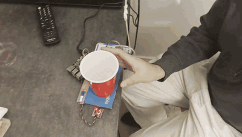</p>

**Quick links:** [code (`tipsy_tulip.py`)](tipsy_tulip.py) · [interaction diagram](#interaction-diagram) · [videos](#video-of-the-working-prototype) · [looks / works / acts like](#part-f)

---

## Part 1

### Lab preparation and Parts A–C

I pulled the Lab 4 content from the class repo into my fork and onto my Pi, set up the Lab 4 virtual environment, and tested each part I ended up using:

| Part | Test script | Result |
|---|---|---|
| SparkFun Qwiic distance sensor (VCNL4040) | `qwiic_distance.py` | reading jumps when a cup is over it |
| SparkFun Qwiic Button | `qwiic_1_button.py` | prints pressed / not pressed |
| SparkFun Servo pHAT + 9g servo | `pi_servo_hat_test.py` | servo sweeps on channel 0 |
| SparkFun Qwiic OLED (128x32) | `oled_test.py` | bouncing circle |

[Testing video: sensor readings, button and servo](testing_sensor_button_servo.mp4)

One thing I learned here: not every example script matches the kit I had. `servo_test.py` drives channel 2 (my servo is on channel 0), `distance_test.py` is for a different laser sensor (VL53L1X), and `qwiic_button_led_demo.py` needs two buttons. Checking `i2cdetect -y 1` (I saw `40`, `60`, `6f`, and later `3c`) was the fastest way to confirm what was actually connected.

---

### Part D
### Physical Interaction Design: Feast Automata

**\*\*\*Draw 5 sketches that explore different physical arrangements for your sensing and actuation.\*\*\***

**Concept: Tipsy Tulip.** A stand for a shot glass with a paper flower that keeps count of your shots by getting "drunk" along with you. Lift the glass, take the shot and put it back, and a distance sensor under the glass counts one shot. A servo tips the flower further with each shot until it flops over at the limit.


1. **Coaster + counting flag:** distance sensor in a hole in a coaster under the glass, facing up; a servo beside it raises a "CHEERS" flag arm one notch higher with each shot.
2. **Side tower + cheers arm:** sensor in a cardboard post next to the glass, facing sideways; a servo on top of the post swings an arm holding a mini cardboard glass that "clinks" the real glass after each shot.
3. **Bartender buddy:** a cardboard bartender with the sensor in its chest facing the glass; a servo in its shoulder makes it wag a finger harder with each shot.
4. **Tipsy-meter dial:** sensor in a base under the glass; a servo needle on a cardboard dial moves one tick per shot from "SOBER" to "TIPSY" to "DONE".
5. **Tipsy tulip:** box base with the sensor under the glass facing up and the Pi + Servo pHAT inside; a paper tulip on a servo at the back corner leans further with each shot and flops over at the limit. A reset button on the front stands it back up.

**\*\*\*What questions do these sketches raise? What do you need to physically prototype to answer them?\*\*\***

- Can the distance sensor reliably see a small, clear shot glass through a hole in cardboard? Does a full glass read differently from an empty one? If not, would a white sticker on the bottom of the glass, or a button under the glass, work better?
- How do I tell a real shot from the glass just being bumped or slid? Should the glass have to be lifted for a couple of seconds and then put back to count?
- How do I protect the sensor and electronics from spills without blocking the sensor? Would plastic film over the hole work?
- How many shots before the flower flops over, and how big should each step be so the change is noticeable from across a table?
- Is a 9g servo strong enough to hold the flower at an angle without sagging, and how do I attach the stem to the servo horn?
- Is there room in the base for the Pi, Servo pHAT and cables, with the glass still sitting directly over the sensor?

To answer these, I need to physically prototype:

- the base with the sensor hole, testing real cups (empty and full) over it with `qwiic_distance.py`
- the flower on the servo horn, to check it's visible and stays steady at each angle

**\*\*\*Pick one design to prototype and explain why.\*\*\***

I picked **sketch 5, the Tipsy tulip**:

- **It's readable at a glance.** The flower mirrors the drinker, so how far it leans tells you roughly how many shots you've had without reading a number. Flopping over at the limit is a clear "you're done" signal that comes across as a joke rather than a lecture.
- **The detection should be reliable.** With the sensor directly under the glass, the glass always sits at the same distance from it.
- **It's mechanically simple.** The whole mechanism is a single servo arm.

Build plan I worked from (front view, top view, cut-away, and how to attach the flower):

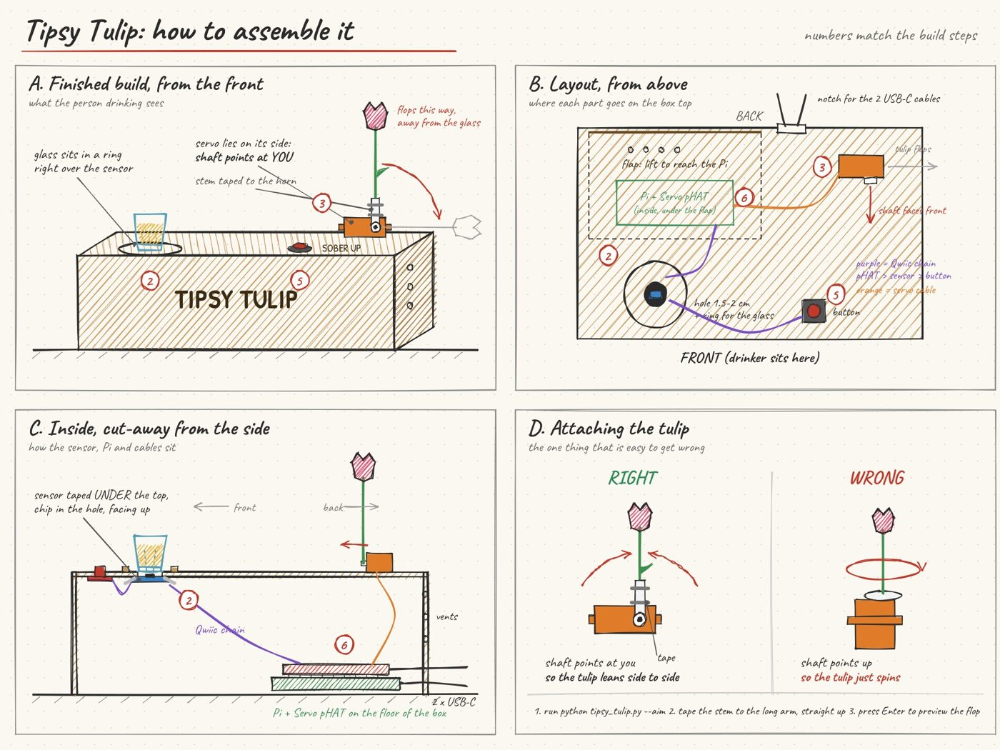

**\*\*\*Document your rough prototype with photos and/or video.\*\*\***

| Base: sensor hole, button, servo at the corner | Cup sitting over the sensor | First flower on the servo |
|---|---|---|
| 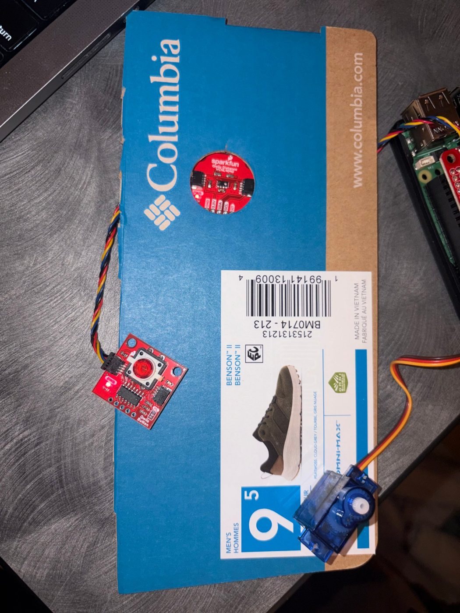 | 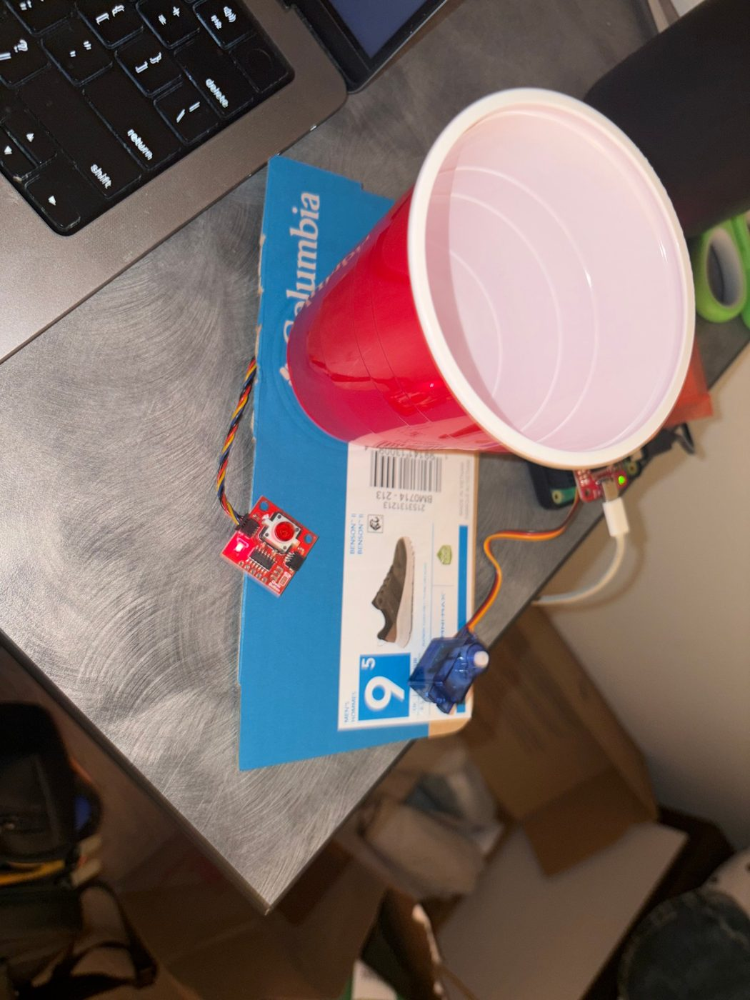 | 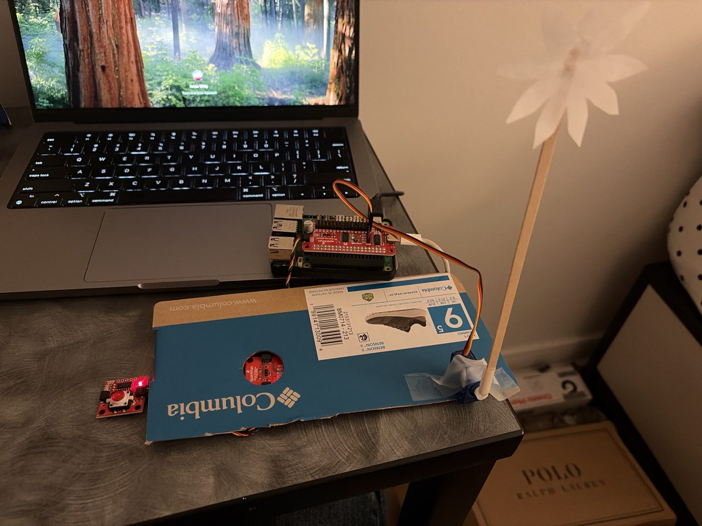 |

The base is a shoebox lid with a round hole cut over the distance sensor. The servo is taped at the corner, lying on its side so its shaft points outward. That way the flower **leans side to side** like a clock hand instead of spinning in place. The flower is paper on a long wooden stick, taped to the single-arm servo horn.

What the rough prototype answered:

- **Detection:** I used a red plastic cup instead of a shot glass. Its solid bottom sits flat over the hole and the sensor sees it clearly, so I didn't need the white-sticker fallback.
- **Attaching the flower:** the horn is a tight press fit, and it only goes on in fixed steps, which turned out to matter later (see the `--setup` iteration below).
- **Space:** for this prototype, the Pi, Servo pHAT and cables sat next to the box instead of inside it. That was easier to reach while debugging, and a Pi 5 needs airflow.

---

## Part 2

### Part E
#### Build & Integrate: Sensing + Actuation

**How it works**

**cup lifted for at least 1 second and put back → distance sensor sees it return → Pi counts a shot → servo leans the flower further (and flops it at 4) + OLED updates + button light gets brighter**

| Shots | Flower | OLED |
|---|---|---|
| 0 | stands straight up | `Shots: 0/4` · `Ready - cheers!` |
| cup lifted | | `Bottoms up!` |
| 1–3 | lurches, wobbles, leans further, sways more each time | `Wait 0:59 - water!` counting down, then `OK to drink` (`OK... last one!` at 3) |
| shot within 60 s of the last | | `Too fast! Slow down` |
| 4 | falls over fast and bounces; button blinks | `CUT OFF (4)` · `No more. Press btn` |
| 5+ | twitches on the floor | `CUT OFF (5)` · `STOP! That's 5` |
| button | slowly stands back up with a little shake | `Sobered up!` |

**Hardware**

- Raspberry Pi 5 + SparkFun Servo pHAT (stacked on the header, powered by its own USB-C), 9g servo on channel 0
- SparkFun Qwiic distance sensor VCNL4040 (`0x60`) under the hole, facing up
- SparkFun Qwiic Button (`0x6F`) for reset
- SparkFun Qwiic OLED 128x32 (`0x3C`)
- One Qwiic chain: **Servo pHAT → distance sensor → button → OLED**

**Code:** [`tipsy_tulip.py`](tipsy_tulip.py)

```bash
cd ~/Interactive-Lab-Hub/Lab\ 4
source .venv/bin/activate
pip install pillow
python tipsy_tulip.py --setup         # once: nudge the flower to set its upright and flopped positions
python tipsy_tulip.py --screen oled   # calibrate (cup off, press button; cup on, press button), then use it
```

#### Interaction diagram

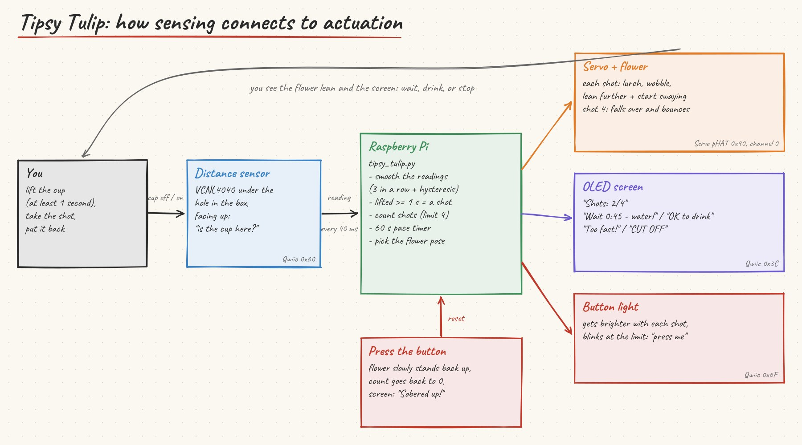

#### Video of the working prototype

| The flower leaning, then flopping | The screen counting, cut-off and reset |
|---|---|
| 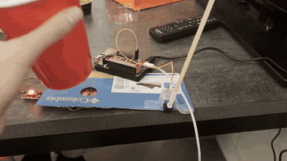 | 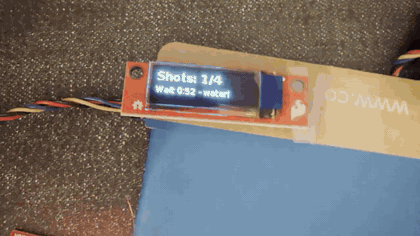 |
| [full video](works_like_flower.mp4) | [full video](works_like_screen_and_reset.mp4) (GIF is 2x speed) |

Someone using it: [full video](acts_like_using_it.mp4) (the GIF at the top is 2x speed).

#### Iterations: what I changed and why

1. **From a fixed threshold to calibration.** The class example hard-codes a threshold, but readings change with the cup, the hole and the light. The script now calibrates at startup: cup off, press the button; cup on, press the button. The threshold sits between the two readings, with a gap (hysteresis) so a reading near the line doesn't flicker.
2. **Deciding what counts as a shot.** The cup has to be gone for **at least 1 second** and then come back, and the sensor has to agree **3 readings in a row**. A quick bump or slide prints "Just a bump, not counted."
3. **Making the motion feel drunk, not mechanical.** Moving straight to the next angle looked robotic. Each shot now overshoots, wobbles back and settles, and the flower keeps swaying, more with every shot. The flop is fast with a bounce, and extra shots get a feeble twitch.
4. **Getting the position and direction right.** Once it was mounted, the flower wasn't quite upright and flopped the wrong way. The horn only fits on in fixed steps, so the servo's usable range depended on how it was pressed on. I added `python tipsy_tulip.py --setup`: you nudge the flower to "straight up" and "flopped" with `+`/`-`, and it saves those angles to `tulip_angles.json`. The flop now falls away from the cup.
5. **Adding feedback beyond the flower.** I added a screen so it says how many shots you've had and whether to drink. I used the Qwiic OLED rather than the Mini PiTFT, because the Servo pHAT takes the GPIO header the PiTFT needs, while the OLED just chains onto the Qwiic cable. I also added a **60-second pace timer** ("Wait 0:45 - water!" / "Too fast! Slow down"), and the count keeps going past the limit instead of hiding it.
6. **Using the button's light.** It gets brighter with each shot and blinks at the limit, so the reset button asks to be pressed exactly when it's needed.

#### Reflection

**What I learned about connecting sensing, movement and physical form:** the sensor only knows whether something is close. It can't tell whether you actually drank. So the interaction had to be designed around what it *can* see: lifting the cup away and putting it back. Where the sensor sits mattered as much as the code. Directly under the cup, behind a hole, the cup is always the same distance away, so the readings were easy to separate. On the movement side, the same servo can look mechanical or alive depending on timing: overshooting, settling and swaying is what makes the flower read as "tipsy." And the physical details (which way the horn points, how long the stem is, which side the flower falls toward) changed the experience as much as any line of code.

**Fun:** the flop. The flower falling over at shot 4 is the payoff of the whole device: a limit that feels like a joke rather than a lecture.

**Surprising:** the pace timer turned out to matter as much as the count. In the screen test, shots taken back to back triggered "Too fast! Slow down" almost every time.

**Challenging:** the physical fitting and the setup. The servo horn was a tight press fit and only goes on in fixed steps, so I had to add the `--setup` mode to get the angles right. I also had to choose between the two screens because of the pin conflict, and match the example scripts to the hardware I actually had.

**Questions to consider**

- *How does the sensor shape the physical response?* It gives a simple on/off "cup is here" signal, so the response is step by step: one lean per shot, rather than a continuous movement.
- *How does the physical arrangement change the interaction?* With the sensor under the cup, the interaction happens where you already put your drink. Putting the flower at the far corner, falling away from the cup, keeps the flop from knocking anything over and makes it visible across the table.
- *What thresholds, timing or movement patterns make it clear or playful?* The 1-second minimum lift and the 3-reading debounce make it reliable. The overshoot-and-sway lean and the fast bouncy flop make it playful. The 60-second pace timer makes the screen say something useful.
- *What changes when you adjust sensor placement or servo motion?* Moving the cup off-center or covering the hole changes the readings, which is why the script calibrates every run. Pressing the horn on one notch over shifts the whole range of motion, which is why `--setup` saves the angles instead of hard-coding them.

---

### Part F
### Final Documentation

#### Looks like
How it sits on the table: the cup over the sensor, the flower at the corner, and the screen and button at the edge.

<p>
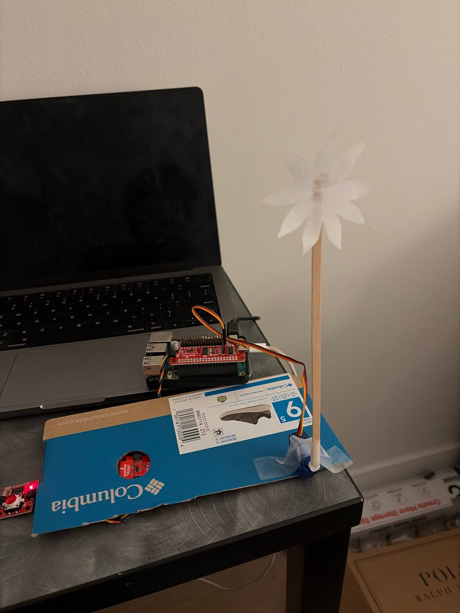
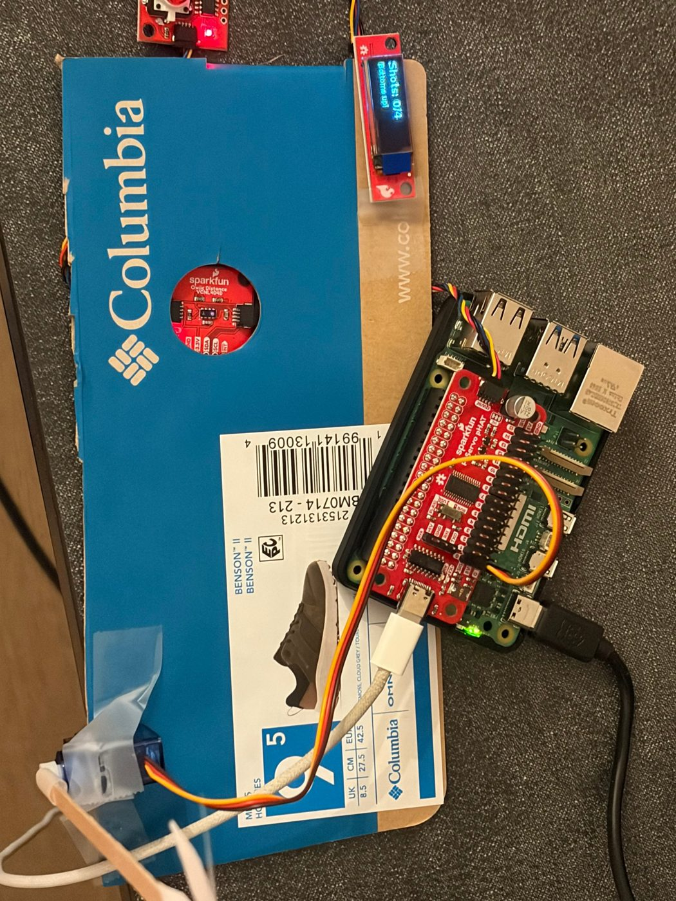
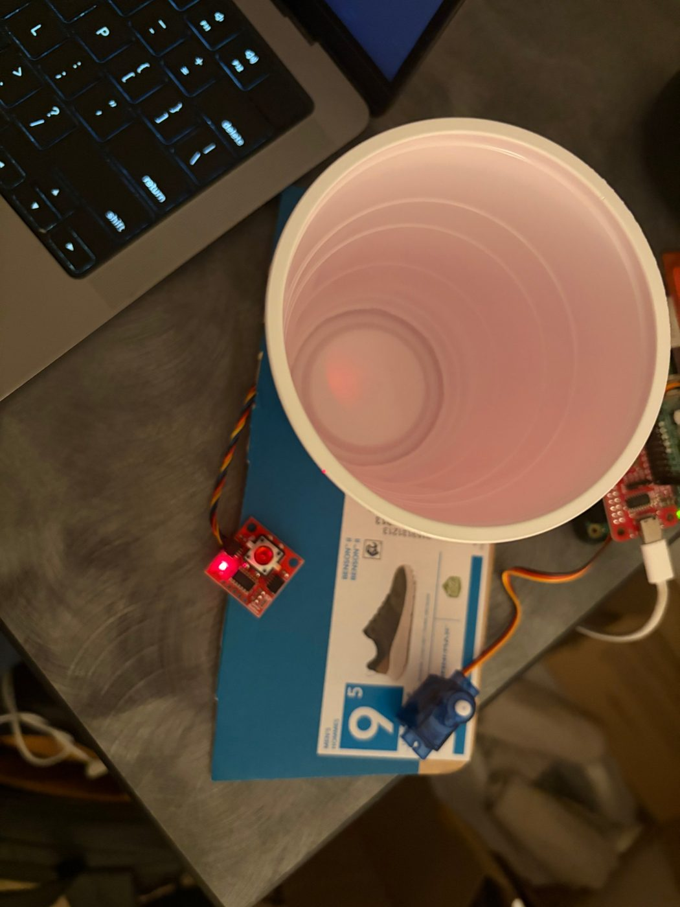
</p>

#### Works like
The sensor counts each shot and the flower leans further, then flops at 4. The screen counts and paces, and the button resets.

<p>
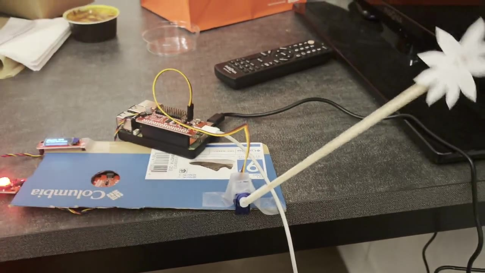
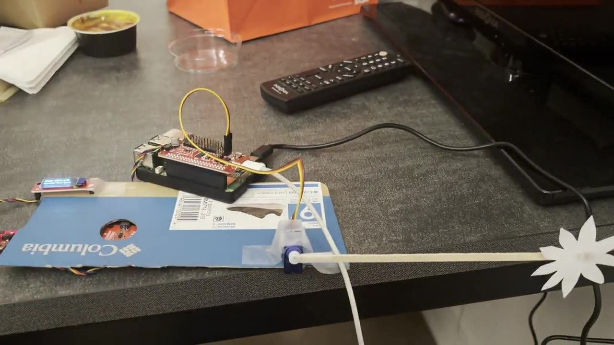
</p>

Videos: [flower leaning and flopping](works_like_flower.mp4) · [screen counting, cut-off and reset](works_like_screen_and_reset.mp4)

#### Acts like
A person sits down, drinks from the cup and puts it back, and the flower and screen react.


[Full video]([acts_like_using_it.mp4](https://youtu.be/x7NnJ_YaQos))

**What I'd change next**

- Hide the Pi and cables inside the box, with vent holes, and mount the screen and button on its front edge.
- Use a shorter, stiffer stem. The long one is dramatic, but it swings hard when it flops.
- Put clear film over the sensor hole to protect it from spills.
- Try a real shot glass with a white sticker on the bottom, as the sketches planned.
