# Observant Systems: Overnight Sensation — Desk Curfew

**Members:** Arnav Whig (aw966, arnavwhig8)
**Project name:** Desk Curfew

A small device on my desk that holds me to the bedtime I promised. Before bed I tell it when I will stop working. All night its camera watches my desk chair, not my bed. In the morning I press its button and it tells me, in one honest sentence, whether I kept my word: *"You said bed by 12:30 a.m., but you were at the desk until 1:46 a.m., 77 minutes late."*

I built it twice. **v1** is the class pipeline almost unchanged, with the language model asked to work out the answer. **v2** moves every fact into code, adds a debouncer, a one-button bedtime ritual and a sentence checker, and lets Qwen only phrase the result.

**Quick links:** [storyboards](#part-f) · [Verplank diagram](#verplank-diagram) · [v1 → v2](#iteration-v1--v2) · [v2 code (`desk_curfew.py`)](desk_curfew/v2/desk_curfew.py) · [logic (`core.py`)](desk_curfew/core.py) · [run sheet (`SETUP.md`)](desk_curfew/SETUP.md) · [final video](#final-documentation)

**Help and influences.** The pipeline is built on the class starter code (`yolo_to_qwen.py`, `overnight.py`, `morning.py`). The screen and button code is adapted from my Lab 4 project (`tipsy_tulip.py`), and the voice is Piper from Lab 3. Shifeng Hong gave feedback on my first storyboard, which changed the revised one (see Part F). I used Claude (Anthropic) as a coding and writing assistant: it helped write the Desk Curfew scripts and tests, drew the storyboard and Verplank images from my descriptions, and drafted this README, which I then edited and filled with my own results.

---

## Part 1

### Part A. Set up the Pi for on-device AI

I created the Lab 5 virtual environment, exported `yolo26n` to NCNN, and installed Ollama with both Qwen models.

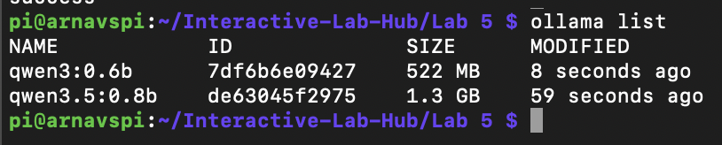

### Part B. See: people in real time with YOLO

I ran `yolo_person.py` over ssh with `--headless`, so the readings are printed rather than drawn: where the person box is, how tall it is (out of 480 px), and the confidence.

**Three situations where it failed:**

| # | Situation | What happened | Likely cause |
|---|---|---|---|
| 1 | Sitting at the desk, **arms covering my face** | `0 object(s)` the whole time, although my body was right in front of the camera. When I lowered my arms it found me again, at 0.44 first and up to about 0.85 within a few looks. | YOLO's idea of a "person" leans heavily on a head and shoulders outline. Arms over the face break that outline, so the rest of the body is not enough. |
| 2 | **Room light off** | `0 object(s)` while I sat in the chair. With a phone torch on me it saw me again, but only at 0.40–0.47 confidence, right at the 0.4 cut-off, so it flickered between "person" and nothing every look or two. | Not enough light: the webcam image is dark and noisy, so the edges the model needs are mostly gone. The torch helped only partly. |
| 3 | **Very close to the camera** (my box filled the whole frame, 475–479 of 480 px tall) | Confidence jumped around (0.56–0.88) with single `0 object(s)` looks in between, even though I was not moving much. | When only my head and chest fill the frame and are cut off at the edges, it no longer looks like a typical full "person" from the training images. |

| Face covered, then uncovered | Dark, with a phone torch | Very close to the camera |
|---|---|---|
| 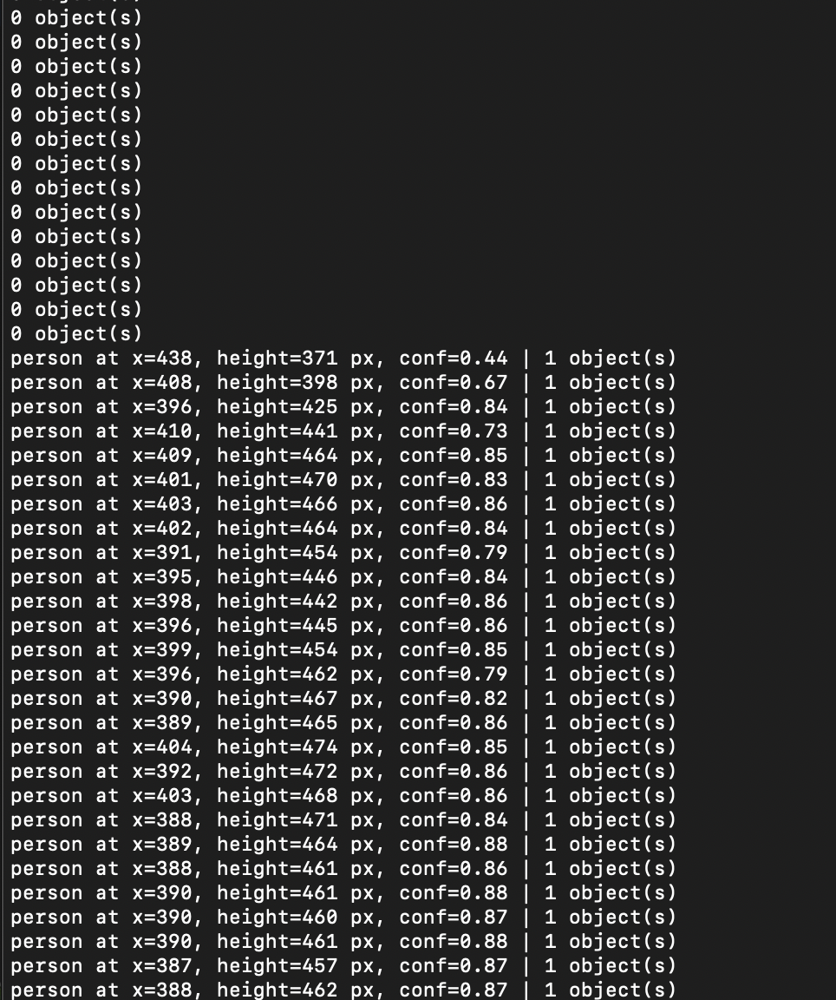 | 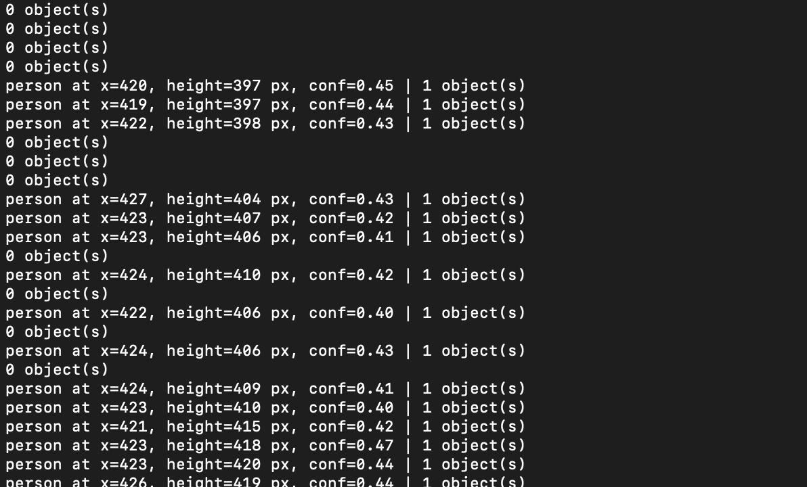 | 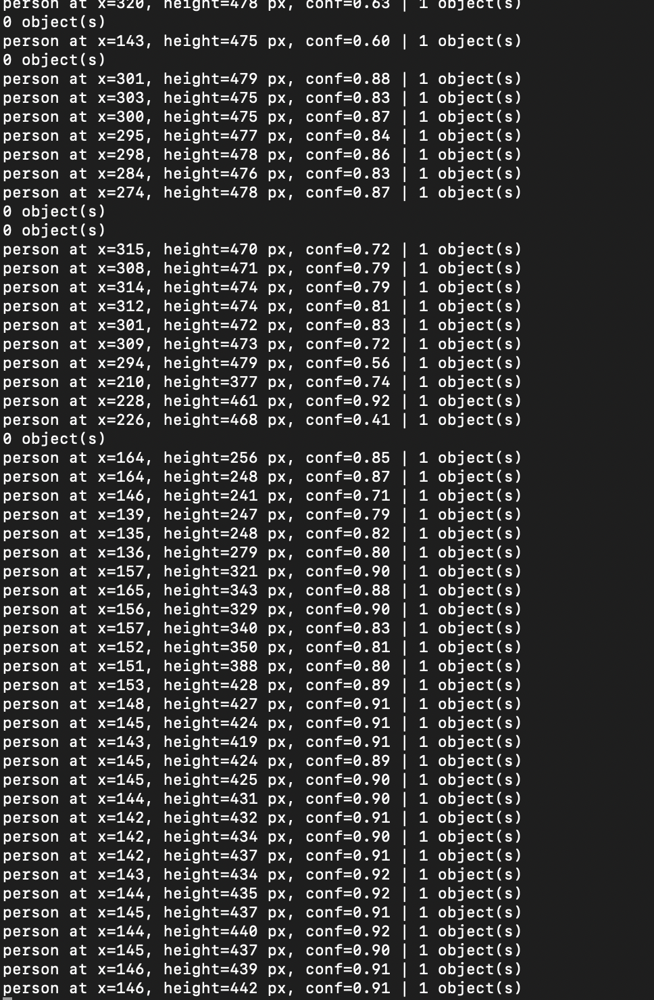 |

These failures shaped v2. A single empty look must not count as leaving the desk, so v2 waits for 3 looks in a row. Darkness gets its own state, `dark`, instead of being silently reported as "empty". And since confidence hovers near the threshold in poor light, the morning report is built from the debounced states, never from one look.

### Part C. See more: hands and pose with MediaPipe

I first ran `hand_pose.py` over ssh, where it cannot open its window (Qt: *could not connect to display*); the demo needs the Pi's desktop through VNC.
<!-- TODO (optional): VNC screenshot of hand_pose.py -->

**How pose tracking could fit Desk Curfew.** A *Quiet Coyote* held up to the camera could replace the button as the bedtime hand-off: the device sees the gesture, says the curfew back and goes dark. Body pose would also let the device tell *working* (upright, hands at keyboard height) from *dozing at the desk* (head dropped below the shoulders for minutes), which a person-detector alone reports as the same "occupied". I kept the button in v2 because a gesture in a dim room at midnight is the least reliable input I tested.

### Part D. Reason: Qwen on the Pi

I asked three questions with `ask_qwen.py` (thinking off, at most three sentences, 120-token cap), and the first one again with the smaller model.

| # | Question | Model | Answer | Time |
|---|---|---|---|---|
| 1 | Tell me a bit about the history of Roosevelt Island. | qwen3.5:0.8b | "Roosevelt Island was originally built as a military barracks during World War I, later repurposed as a federal housing project for displaced workers in the 1930s. It remains one of the most densely populated residential areas in New York City today." | 12.2 s |
| 1b | (same) | qwen3:0.6b | "Roosevelt Island was established in 1904 as a temporary refuge for displaced families from the Great Depression. It was initially a small island in the Pacific Northwest, but by the 1930s, it became a significant community. …" (four sentences) | 10.8 s |
| 2 | Is it unusual for someone to be at their desk at 2am? | qwen3.5:0.8b | "Yes, it is quite unusual for someone to be at their desk at 2 am. Most people wake up around 7 or 8 AM and finish work by noon, leaving the office open during the night hours. However, some individuals choose to stay late due to a specific job requirement or personal preference." | 10.1 s |

**Comparison.** Neither model got any of the four facts I could check (Blackwell's Island, then Welfare Island, renamed Roosevelt Island in 1973, Cornell Tech in 2017). The 0.8B model invented a World War I barracks and a 1930s housing project; the 0.6B model was worse, with a "refuge from the Great Depression" founded in 1904 and an island in the Pacific Northwest. It was a little faster (10.8 s vs 12.2 s) and also ignored the three-sentence limit. The 2am answer starts sensibly and then says most people "finish work by noon". All three answers are fluent and confident, which is exactly why Desk Curfew never asks the model for a fact: it only lets it phrase facts the code has already worked out.

### Part E. Connect: YOLO readings to Qwen reasoning

I ran `yolo_to_qwen.py --headless` for its default 60 s: I sat at the desk, walked out of frame for about 20 s, and came back.

```
23:04:54 1 person(s) at center/close
23:04:57 2 person(s) at center/close, center/close
23:04:57 1 person(s) at center/close
23:04:59 2 person(s) at center/close, center/close
23:05:00 1 person(s) at center/close
23:05:01 2 person(s) at center/close, center/close
23:05:01 1 person(s) at center/close
23:05:04 nobody
23:05:05 1 person(s) at center/close
23:05:06 1 person(s) at right/close
23:05:09 nobody
23:05:32 1 person(s) at right/close
23:05:34 1 person(s) at center/close

13 lines saved to watch_log.txt
asking Qwen...

Qwen (11.7 s):
There were initially 1 person at the center/close, then 2 people appeared at that location. Later, a second person joined them to make 3 people total. After some time, only 1 person remained at the center/close. No one was seen anywhere else in the room during this 61-second observation.
```

**What I took from Part E.** I was alone the whole time. YOLO drew two overlapping boxes around me three times ("2 person(s) at center/close, center/close"), and because the log records every change, each double box became an "event". Qwen then built a story on it: a second person appeared, a third one joined, "3 people total". It also missed the one thing that really happened (the desk was empty for 23 seconds, 23:05:09 to 23:05:32) and said nobody was seen anywhere else, although the log says "right/close" twice. The interpreter decides everything the model can know, and a small model will explain every flicker rather than ignore it. That is why Desk Curfew's interpreter only answers "is someone at the desk?", waits for several looks to agree, and keeps the counting in code.

---

## Part 2: Overnight Sensation

### Part F

#### Idea

I always tell myself "bed by 12:30" and then find myself at the desk at 2am without noticing. Desk Curfew is the roommate who saw you still up and tells you so, kindly but plainly, over breakfast. It is a *sense all night* device: the camera faces the desk chair, so it knows when I am working and nothing about my sleep.

#### Storyboard (v1)

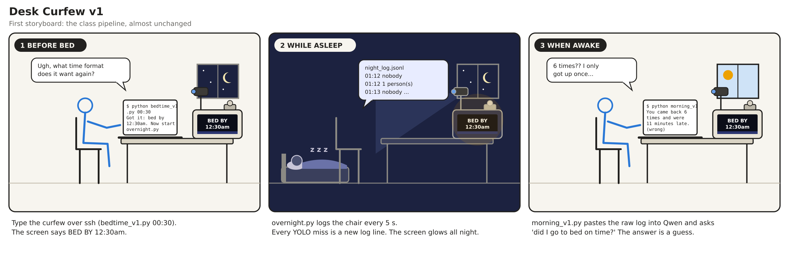

1. **Before bed:** I type the curfew over ssh (`bedtime_v1.py 00:30`) and start the class's `overnight.py`.
2. **While asleep:** `overnight.py` logs the chair every 5 s, one line per change.
3. **When awake:** `morning_v1.py` pastes the raw log into Qwen and asks whether I went to bed on time.

#### Bellotti's five questions

| Question | Desk Curfew's answer |
|---|---|
| **Address**: how do I talk to it? | One button on top: tap / hold before bed, press in the morning. Sitting in the chair addresses the camera without trying. |
| **Attention**: how do I know it is listening? | It says the curfew back, then the button LED breathes dimly all night. |
| **Action**: what can I make it do? | Set tonight's curfew, and ask for the verdict. Nothing else, on purpose. |
| **Alignment**: how do I know it did the right thing? | The morning screen shows the number it based its sentence on, and a timeline of the night is saved. If the camera stopped watching, the sentence says so. |
| **Accident**: how do I recover from a mistake? | The dial wraps around; Ctrl-C still produces a morning; `--replay` recomputes a morning from the saved log; a wrong model sentence is replaced by a safe one. |

### Prep for Part 2

**Feedback on my storyboard** (from Shifeng Hong):

> \+ visual is clean and structured
>
> \- it will be best to highlight the chair and the range of what the camera is monitoring. I did not figure out what the yolo is monitoring at the beginning

**What I changed because of it.** Shifeng is right that the v1 storyboard never shows *what* the camera watches. In the revised storyboard a dashed box marks the chair in every panel, labelled "the camera watches this chair only", and the camera's field of view is drawn reaching it. The device itself answers the same question: `desk_curfew.py --check` prints, once a second, exactly what YOLO sees (person or not, how tall the box is, how bright the frame is) and saves `aim.jpg` with YOLO's boxes drawn on the frame, so you can point the camera at the chair before the night starts (see Part H). And the v2 interpreter only counts a person whose box is tall enough to be sitting in that chair, so someone walking past in the background is not "at the desk".

**Where the device spends the night:** the webcam faces my desk chair, not the bed, and everything stays on the Pi. <!-- TODO: who you live with, and that they are OK with it -->

#### Revised storyboard (v2)

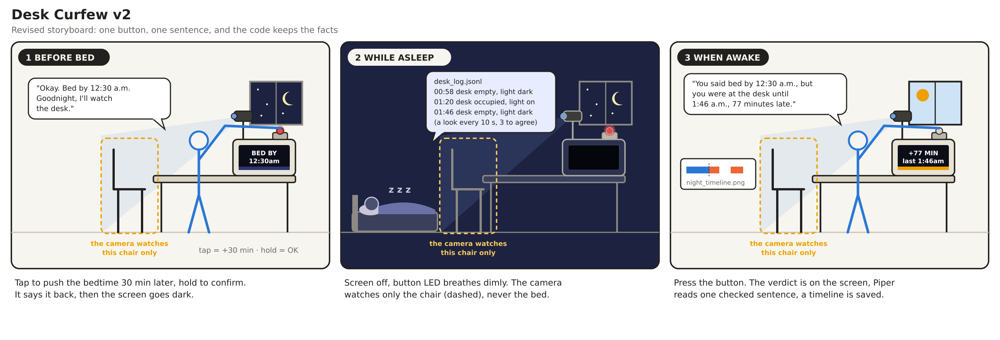

What changed, and why:

- **What the camera watches** (Shifeng's feedback): a dashed box marks the chair in every panel, and the camera's view is drawn reaching it.
- **Hand-off:** typing a time over ssh at midnight is not a ritual. v2 offers a time on the screen; tap to push it 30 minutes later, hold to confirm. It answers out loud, then goes dark.
- **The screen at night:** v1 left `BED BY 12:30am` glowing all night. v2 turns the screen off and keeps only a dim, slowly breathing LED.
- **The facts:** v1 asked Qwen to find the last time I was at the desk and do the arithmetic. v2 does that in code and gives Qwen a short list of checked facts to phrase.
- **The reveal:** v1's answer was text in a terminal. v2 shows the verdict on the screen, and can read the sentence aloud with Piper (Lab 3).

#### Verplank diagram

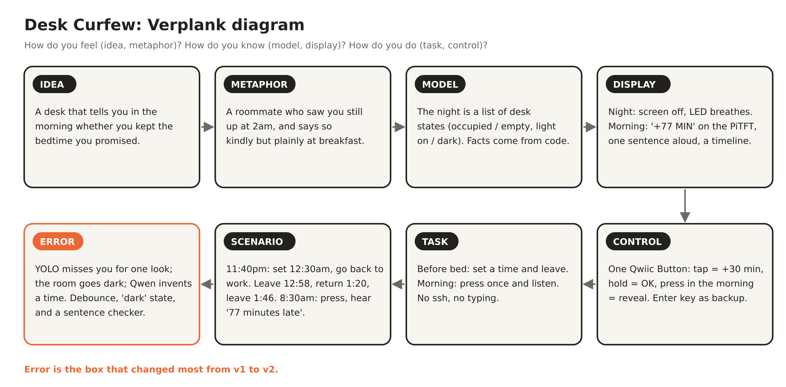

### Part G. The interaction before bed

1. The screen shows **BED BY 12:00am** (the next half hour, at least 30 minutes away).
2. **Tap** the button to push it 30 minutes later (it wraps around after 4 hours). **Hold** for a second to confirm, or just leave it for 15 s.
3. The device says *"Okay. Bed by 12:30 a.m. Goodnight, I'll watch the desk."*, shows **GOODNIGHT 12:30am**, then the screen goes dark and the button LED starts a slow, dim breathing.

The whole ritual takes under thirty seconds and needs no laptop. Without a Qwiic Button it uses the Mini PiTFT's two buttons, and without either it uses the Enter key.

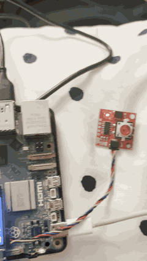

The bedtime ritual on the real device ([video](desk_curfew/media/v2_bedtime.mp4)): the screen offers **BED BY 10:45pm**, one tap makes it **10:46pm**, holding the Qwiic Button confirms, the screen says **GOODNIGHT · watching the desk** and goes dark, and the button LED keeps glowing.

### Part H. The observant system at night

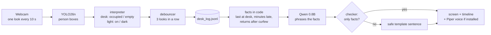

**The interpreter** ([`Eyes.look()`](desk_curfew/v2/desk_curfew.py)) is the main change from Part E. It answers two questions instead of describing positions:

| Reading | Rule | Why |
|---|---|---|
| `desk: occupied` | a person box at least 30% of the frame tall | someone walking past at the back of the room is not *at the desk* |
| `desk: empty` | no such box | |
| `light: dark` | mean brightness under 40 | in the dark the camera cannot see, so "dark" is reported as its own state, never silently as "empty" |

**The debouncer** ([`core.Debouncer`](desk_curfew/core.py)) changes a state only after 3 looks in a row agree (30 s), and timestamps the change from the first look that saw it. Short absences under 3 minutes (water, a YOLO miss) are merged, so they do not count as leaving. A heartbeat is written every 5 minutes, so a long silence in the log means the script stopped, and the morning says so.

**Tuning the interpreter with `--check`.** Before the first night I ran `desk_curfew.py --check` for 30 s while sitting, leaning back, walking away and switching the light off:

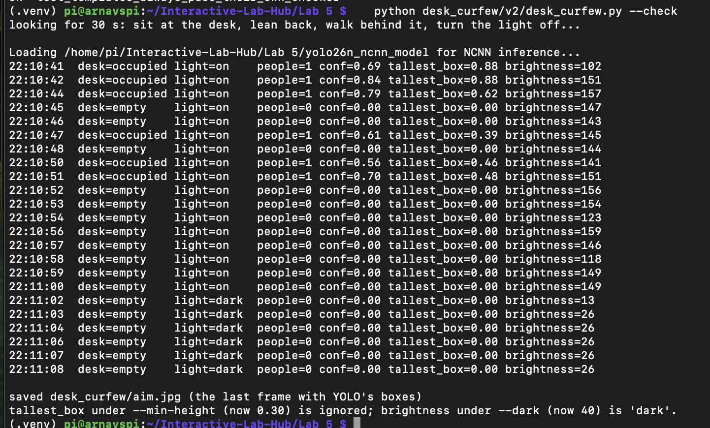

- Sitting gave person boxes 0.62–0.88 of the frame height; leaning back 0.39–0.48. Both clear the 0.30 cut-off, so leaning back still counts as being at the desk.
- Brightness was 102–159 with the light on and 13–26 with it off, so the 'dark' threshold of 40 separates them cleanly.
- Leaning back also produced one or two empty looks in a row (22:10:45–48) while I never left the chair. That is the flicker the debouncer and the merging of short gaps are there for.

**The v2 demo night in the terminal.** 275 looks, 3 s apart, and only four lines in the log, because a state changes only after the looks agree (one flicker was ignored):

```
Button: qwiic (+ Enter key)
Screen: PiTFT
BEDTIME: tap = +1 min, hold = confirm (or wait 15 s)
  bed by 10:45pm?
  bed by 10:46pm?
Goodnight. Curfew 10:46pm. Watching the desk.
night shift: a look every 3 s. Press the button (or Ctrl-C) in the morning.

22:42:36  desk occupied light on   (conf 0.85, box 0.97, brightness 97)
22:47:15  desk empty    light on   (conf 0.00, box 0.00, brightness 150)
22:50:28  desk occupied light on   (conf 0.52, box 0.55, brightness 153)
22:53:31  desk empty    light dark (conf 0.00, box 0.00, brightness 26)
```

That is exactly what I did: sat until 10:47, left, came back at 10:50, switched the light off and left at 10:53.

### Part I. The interaction when awake

Press the button. The device:

1. Works out the facts in code ([`core.compute_facts`](desk_curfew/core.py)): the last time I was at the desk, minutes past curfew, returns after curfew, when the desk went dark. A session that starts in the morning (more than 5 hours after curfew, or in the last 3 minutes before the press) is me walking up to the button, not a late night.
2. Gives Qwen only those facts and asks for at most two sentences.
3. **Checks the sentence** ([`core.check_sentence`](desk_curfew/core.py)). Every time and number in it must be one of the facts, and it must not call a late night "on time" or the other way round. If it fails, or Ollama is not running, the device uses its own template sentence, which is always true.
4. Shows the verdict on the Mini PiTFT (amber **+7 MIN / last at desk 10:53pm**, or green **ON TIME**), reads the sentence aloud with Piper if it is installed, and saves `morning_report.txt` and a timeline image. (Piper was not installed on my Pi for the demo night, so the device fell back to silence; the sentence went to the terminal and the report.)

**Honest about a quiet night.** If I was never at the desk after saying goodnight, the morning says exactly that: *"Nobody was at the desk after you said goodnight, so bed by 12:30am it was."* The model is not asked to make anything up.

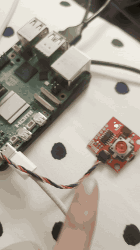

The morning on the real device ([video](desk_curfew/media/v2_morning.mp4)): one press, **GOOD MORNING … reading the night** while Qwen works (14 s), then **+7 MIN · last at desk 10:53pm**.

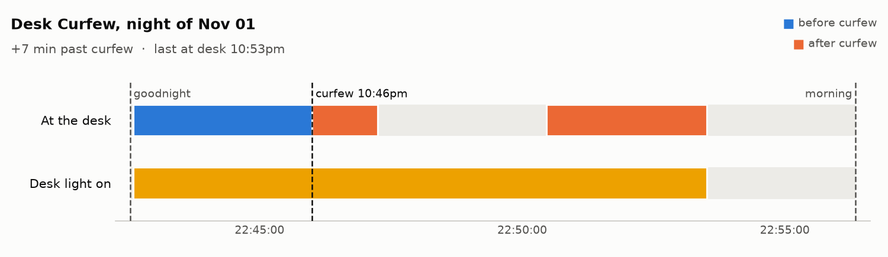

The [morning report](desk_curfew/nights/20261101-2242-demo/morning_report.txt):

```
DESK CURFEW  night of Sun Nov 01
watched 10:42pm to 10:56pm, curfew 10:46pm
screen:   +7 MIN  /  last at desk 10:53pm
sentence: It is 10:53pm and you have been awake for over an hour past your curfew. I know you are tired, but please rest now.
          (from qwen; Qwen took 14.2 s)
sessions at the desk: 2 (from 2 before merging short breaks)
flickers ignored by the debouncer: {'desk': 1, 'light': 0}
looks taken: 275
```

**What went wrong: the sentence.** The facts and the screen were right (7 minutes late, last at the desk at 10:53pm), but Qwen's sentence was not: it said *"over an hour past your curfew"*, and *"It is 10:53pm"* as if that were the time now. My checker let it through, because it only checked digits, clock times and number words, and "an hour" is none of those. So I tightened it ([`core.check_sentence`](desk_curfew/core.py)): a sentence that talks about hours when the night was minutes is rejected, and a late-night sentence must actually state how many minutes late it was. This exact sentence is now a [test case](desk_curfew/tests/test_core.py) and is rejected, so on a night like this the device would have said its own, always-true sentence instead: *"Good morning. You said bed by 10:46pm, but you were at the desk until 10:53pm, 7 minutes late. You came back 1 time after curfew."*

---

## Iteration: v1 → v2

Both versions watched the same acted-out night (see [`SETUP.md`](desk_curfew/SETUP.md#5-run-v1-the-first-prototype-15-min)): work past the curfew, leave, come back, leave with the lamp off, return in the morning.

| | v1 | v2 |
|---|---|---|
| **Before bed** | type `bedtime_v1.py 00:30` over ssh | tap / hold one button; it says the time back |
| **Interpreter** | class `interpret()`: position and distance | `occupied / empty` + `light on / dark`, tall boxes only |
| **Flicker** | every miss is a new log line | 3 looks to change, gaps under 3 min merged |
| **Who works out the answer** | Qwen, from the raw log | code; Qwen only phrases it |
| **When the model is wrong** | nothing catches it | the checker replaces the sentence (tightened after the demo night, see Part I) |
| **Screen at night** | stays on | off, LED breathes |
| **Morning** | text in a terminal | one press: screen verdict, sentence (voice if Piper is installed), timeline |

**v1's night** (curfew 10:21pm). What I actually did: sat until 22:24, left, came back at 22:27, turned the light off and left at 22:30, came back at 22:33 to stop it. [`overnight.py`'s log](desk_curfew/v1/results/20261101-2233/night_log.jsonl) has 14 readings:

```
22:18:31 1 person(s) at center/close
22:21:24 2 person(s) at center/close, left/close    <- a second "person" for one look
22:21:29 1 person(s) at center/close
22:24:06 nobody                                     <- I left
22:25:30 1 person(s) at center/close                <- I was out of the room:
22:25:35 nobody                                        two one-look "people"
22:26:07 1 person(s) at center/close                   that were not there
22:26:12 nobody
22:27:24 1 person(s) at center/close                <- I came back
22:27:30 nobody                                     <- a 30 s flicker while I sat
22:28:01 1 person(s) at center/close
22:30:07 1 person(s) at left/close                  <- standing up to switch the light off
22:30:12 nobody                                     <- I left for the night
22:33:15 1 person(s) at center/close                <- the "morning": me, back to press Ctrl-C
```

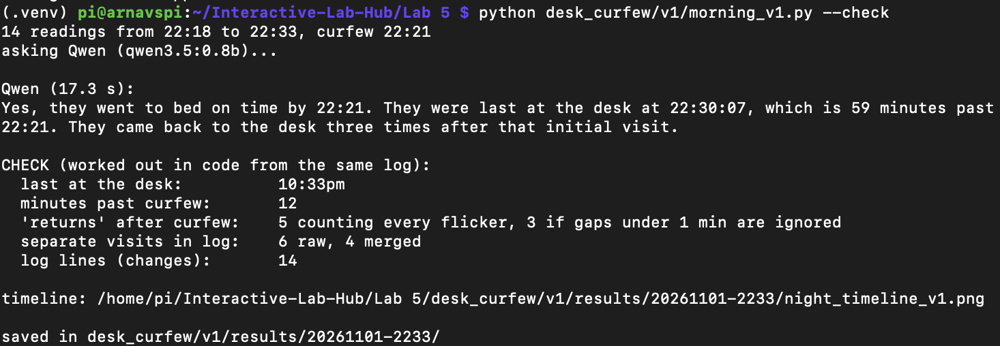

| | What happened | v1: Qwen | v1: the same log counted in code |
|---|---|---|---|
| Went to bed on time? | no | **"Yes, they went to bed on time"** | no |
| Last at the desk | 10:30pm | 22:30:07 | 10:33pm (counts the morning walk-up) |
| Minutes past curfew | 9 | **59** (in the sentence after "on time") | 12 |
| Returns after curfew | 1 (22:27) | "three times" | 5 counting every flicker, 3 merged |
| Separate "visits" in the log | 2 | | 6 |
| Time to answer | | 17.3 s | instant |

**v2's night** (curfew 10:46pm), the same routine: sat until 10:47, left, came back at 10:50, light off and left at 10:53, back at 10:56 to press the button.

| | What happened | v2: facts (code) and screen | v2: Qwen's sentence |
|---|---|---|---|
| Went to bed on time? | no | late, **+7 MIN** on the screen | "past your curfew" |
| Last at the desk | 10:53pm | 10:53pm | "It is 10:53pm" (as if it were the time now) |
| Minutes past curfew | 7 | 7 | **"over an hour"** |
| Returns after curfew | 1 (10:50) | 1 | not mentioned |
| Separate "visits" in the log | 2 | 2 (1 flicker ignored) | |
| Morning walk-up counted? | | no | |
| Time to answer | | instant | 14.2 s |

v1's raw timeline (each bar is one "visit" in `overnight.py`'s log):

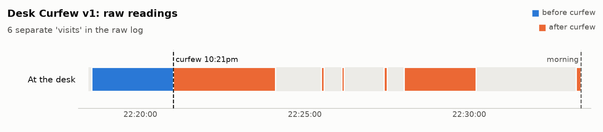

**What I learned.** On the same acted night, v1's raw log had 6 "visits" for my 2 real ones (including two "people" while I was out of the room), and Qwen turned it into a contradiction: "on time" and "59 minutes past" in back-to-back sentences, for a night that was 9 minutes late. Moving the facts into code fixed the numbers completely: v2's screen said +7 MIN, last at the desk 10:53pm, which is exactly what happened. But the model still found a way to be wrong in words ("over an hour"), which taught me that a guard on a language model has to check what the sentence *means*, not just the digits in it. The safest part of the device is the one that never asks the model at all: the number on the screen.

---

## Final documentation

**Looks like.**

| At night: screen dark, button LED on | In the morning: one press, the verdict |
|---|---|
| 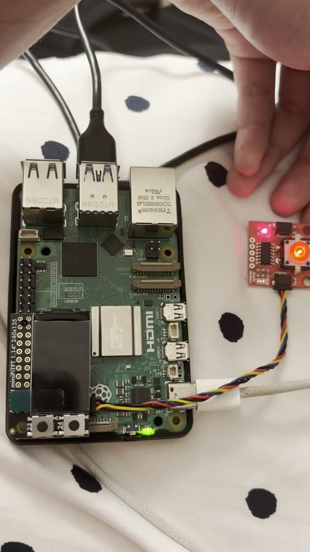 | 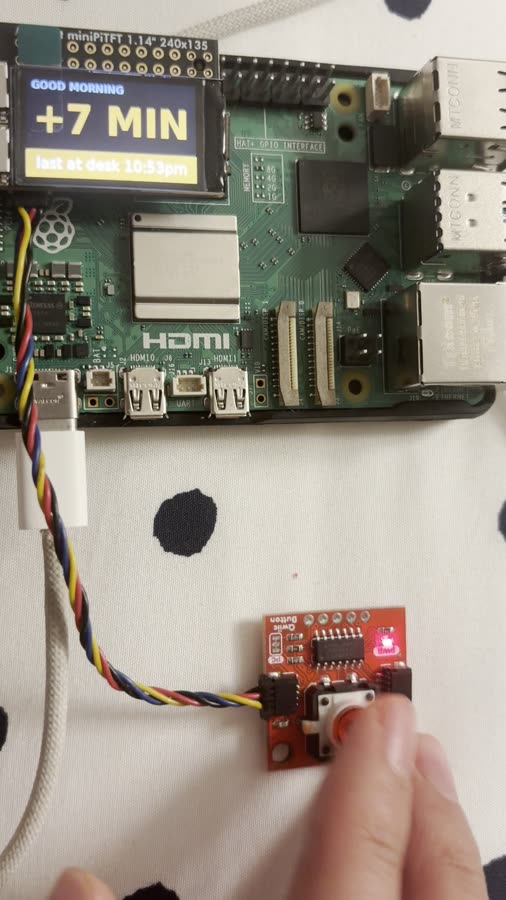 |

**Works like.** The pipeline above, with the logs from both runs:
- v1: [`desk_curfew/v1/results/20261101-2233/`](desk_curfew/v1/results/20261101-2233/) (night log, prompt, Qwen's answer, the check, timeline)
- v2: [`desk_curfew/nights/20261101-2242-demo/`](desk_curfew/nights/20261101-2242-demo/) (`desk_log.jsonl`, `meta.json`, `morning_report.txt`, `night_timeline.png`)

These are compressed demo nights of about 15 minutes, acted out with the same timing for both versions and with the curfew set a few minutes ahead. The device runs the same code on a real night; only the look interval, the dial step and the grace periods change (`--demo` vs default).

**Acts like.** Before bed: tap, hold, see the time said back, watch the screen go dark. In the morning: one press, one number on the screen, one sentence.

**Video of the whole system** (1 min): [`desk_curfew_demo.mp4`](desk_curfew/media/desk_curfew_demo.mp4): the bedtime ritual, a cut over the 15-minute acted night, and the morning press with the verdict.

### Code

| File | What it does |
|---|---|
| [`desk_curfew/v1/bedtime_v1.py`](desk_curfew/v1/bedtime_v1.py) | v1 hand-off: saves the curfew, shows it on the screen |
| [`overnight.py`](overnight.py) | v1 night shift: the class script, unchanged |
| [`desk_curfew/v1/morning_v1.py`](desk_curfew/v1/morning_v1.py) | v1 morning: raw log → Qwen; `--check` compares with the true answer |
| [`desk_curfew/v2/desk_curfew.py`](desk_curfew/v2/desk_curfew.py) | v2: bedtime dial, night watch, morning reveal, `--check`, `--demo`, `--replay` |
| [`desk_curfew/core.py`](desk_curfew/core.py) | the logic: debouncer, sessions, facts, template, sentence checker |
| [`desk_curfew/hardware.py`](desk_curfew/hardware.py) | button, screen, voice, each with a fallback |
| [`desk_curfew/timeline.py`](desk_curfew/timeline.py) | the night as a timeline image |
| [`desk_curfew/tests/test_core.py`](desk_curfew/tests/test_core.py) | 18 tests of the logic, including the demo night's bad sentence, runnable without a Pi |
| [`desk_curfew/storyboard/make_storyboards.py`](desk_curfew/storyboard/make_storyboards.py) | draws the storyboards and the Verplank diagram |

**Privacy.** Everything stays on the Pi. The camera faces the chair, not the bed. Snapshots are deleted after the demo and are ignored by git.
